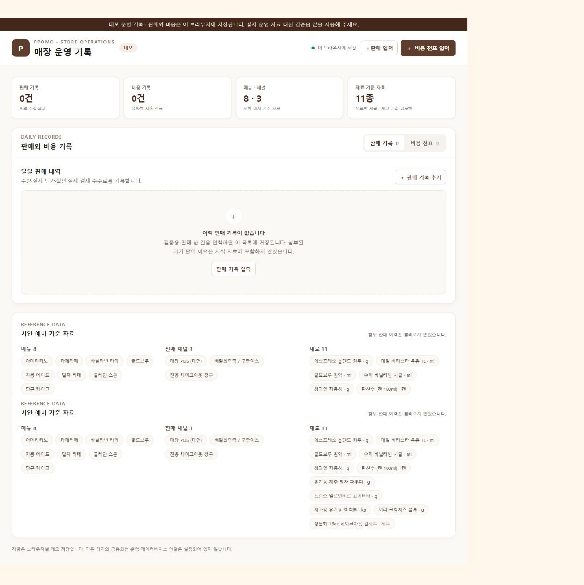

# 테스트 결과

**확인 대상:** EPIC 1 — 기록을 저장하고 바로잡기  
**상태:** 자동 검사와 구현자 브라우저 검사는 통과했습니다. 사용자의 화면 확인을 기다리는 중이며, 아직 EPIC 완료로 표시하지 않았습니다.  
**확인 날짜:** 2026-09-28

## 구현 범위

- 시안 기준 메뉴 8개, 판매 채널 3개, 재료 11개를 운영 화면에 표시합니다.
- 판매와 비용 전표를 입력·수정·삭제하고, 필수값과 숫자 범위를 검증합니다.
- 판매 금액 미리보기와 할인 검증을 제공합니다. 결제 수수료는 실제 금액을 입력합니다.
- 저장 자료를 다시 읽어도 같은 브라우저에서 유지합니다. 첨부된 과거 판매 이력은 시작 데이터에 넣지 않았습니다.
- 운영 화면: [`/operations`](http://127.0.0.1:3000/operations)

## 자동 검사 및 구현자 브라우저 검사

| 검사 | 결과 |
|---|---|
| `pnpm run typecheck` | 통과 |
| `pnpm run build` | 통과 — Next.js 14.2.35 현재 환경에서 정적 페이지 생성 완료 |
| 운영 화면 응답 | 통과 — 로컬 미리보기에서 HTTP 200 |
| 초기 기준 자료 | 통과 — 메뉴 8개, 채널 3개, 재료 11개 표시; 첨부 과거 이력 미표시 |
| 판매 입력·계산 | 통과 — 2개 × 4,500원 − 할인 1,000원 = 순매출 8,000원; 실제 수수료 100원 별도 표시 |
| 잘못된 할인 차단 | 통과 — 총액 9,000원보다 큰 할인 10,000원은 저장되지 않고 안내 표시 |
| 판매 수정·재조회 | 통과 — 할인액을 500원으로 바꾸면 순매출 8,500원; 새로고침 뒤 유지 |
| 비용 입력·수정·재조회 | 통과 — 테스트 전표 1,000원을 항목·금액 1,500원으로 수정하고 새로고침 뒤 유지 |
| 판매·비용 삭제 | 통과 — 화면 내 삭제 확인 후 테스트 전표가 목록에서 사라짐 |
| 테스트 자료 정리 | 통과 — 현재 브라우저의 판매·비용 목록은 비어 있으며 기준 자료만 표시 |

## 사용자가 확인할 행동과 예상 결과

브라우저에 운영 화면을 열어 두었습니다: [매장 운영 기록](http://127.0.0.1:3000/operations). 아래 순서로 확인해 주세요.

1. 화면의 기준 자료를 확인합니다. 메뉴 **8개**, 판매 채널 **3개**, 재료 **11개**가 보이고 판매·비용 건수는 각각 **0건**이어야 합니다. 첨부 과거 판매 이력은 나타나지 않습니다.
2. **판매 입력**을 누르고 오늘 날짜, 매장 POS, 아메리카노, 수량 **2**, 개당 단가 **4,500원**, 할인 **1,000원**, 실제 수수료 **100원**을 입력합니다. 저장 전 순매출 미리보기와 저장된 행이 모두 **8,000원**이어야 합니다.
3. 할인액을 총 판매액보다 큰 **10,000원**으로 바꾸고 저장을 누릅니다. 저장되지 않고 할인액 오류 안내가 보여야 합니다. 할인액을 **1,000원**으로 되돌려 저장하면 행이 나타납니다.
4. 판매 행의 **수정**을 눌러 할인액을 **500원**으로 바꿉니다. 저장 후 순매출이 **8,500원**으로 바뀌고, 새로고침 뒤에도 같은 값이어야 합니다.
5. **비용 전표** 탭에서 같은 날짜, 비용 항목 `소모품 확인`, 구분 `소모품비`, 금액 **1,000원**을 입력합니다. 표에 날짜·항목·구분·금액이 나타나고 새로고침 뒤에도 남아 있어야 합니다.
6. 비용 행을 수정해 금액을 **1,500원**으로 바꿉니다. 저장 후 표와 새로고침 뒤 모두 **1,500원**이어야 합니다.
7. 판매·비용 각 행의 **삭제**를 눌러 화면 내 확인창에서 삭제를 선택합니다. 해당 행이 사라지고 요약 건수가 **0건**으로 돌아와야 합니다.

문제없이 확인하셨다면 **“EPIC 1 확인 완료”**라고 알려 주세요. 그때 이 문서에 사용자 확인 결과를 추가하고 개발 계획에서 EPIC 1만 완료로 표시하겠습니다. 문제가 있으면 단계와 실제 결과를 알려 주세요. 해당 동작을 고친 뒤 다시 확인하겠습니다.

## 저장 범위와 제한

- 현재 입력 자료는 Supabase가 아니라 브라우저의 `localStorage`에 저장됩니다. 같은 브라우저 프로필에서 새로고침하거나 다시 열면 유지되지만 다른 기기·브라우저와 공유되지 않습니다.
- 따라서 이번 검사는 브라우저 데모 저장 동작을 확인한 것입니다. 운영용 데이터베이스 연결이나 여러 사용자 간 저장은 확인하지 않았습니다.
- 계획의 Next.js 16.x 업그레이드는 이번 EPIC 범위에 포함되지 않아 현재 설치된 Next.js 14.2.35에서 검사했습니다.

